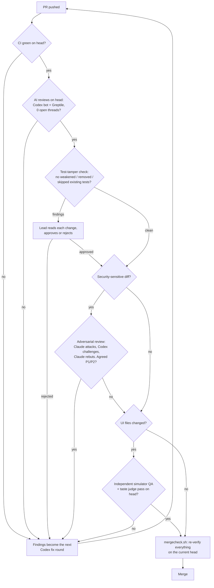

# Merge gate: an AI-assisted PR pipeline for a solo iOS app

> **Excerpt, not a product.** These scripts are copied from the private repo of my iOS app (Expo / React Native + Supabase).
> Paths, account names and device IDs were replaced with environment variables, and the rest of the toolchain
> (the build loop, the simulator agent, the app itself) is not included. They will not run standalone; they are here to show the design.

I build the app mostly alone, with AI coding agents (Codex and Claude) writing a large share of the code. That makes the
question "is this PR actually safe to merge?" the bottleneck. These scripts answer it mechanically: a PR is only
reported ready when CI is green, two independent AI reviewers have looked at the exact head commit with no open threads,
no existing test was quietly weakened, security-sensitive changes survived an adversarial two-model review, and UI changes
passed simulator QA by an agent that did not write the code. `mergecheck.sh` refuses to print `OK ready to merge` until every one of those holds.

## Gate flow

Every check is pinned to the head SHA. A verdict recorded on an older commit never counts.

## How each gate works

| Gate | Files | What it does |
|---|---|---|
| Shared helpers | `lib.sh` | Classifies a diff: `sec_sensitive` (migrations, Edge Functions, auth, payments, RLS/grant text), `risk_tier` (light / normal / heavy), `door_of` (one-way vs two-way door), plus Codex-bot state per head and the tamper hash. |
| Wait for CI + reviewers | `prwait.sh`, `prgate.sh`, `findings.sh` | Requests a Codex bot review (pushes don't trigger it), waits for CI and the bot on the current head, then turns unresolved, non-outdated review threads into the next fix prompt. Outdated threads are listed separately for a human to verify. |
| Test-tamper alarm | `tamper.py`, `tamperok.sh` | Reads the branch diff and flags removed or changed assertions, deleted test files, and added `skip` / `only` / `todo` in existing tests. Merge is blocked until the Lead approves exactly that set of findings (a hash, so a new tamper re-alarms). |
| Adversarial security review | `secgate.sh`, `secdelta.py`, `secaccept.py`, `secaccept.sh` | A read-only Claude pass attacks the diff with a security checklist; a read-only Codex pass confirms, lowers or rejects each finding with evidence and adds misses; Claude rebuts once. Challenges without a `file:line` are ignored. Agreed P1/P2 fail the gate. Results are cached per head; a PASS carries over only when the new commits are provably trivial. |
| Simulator QA | `qa-prompt.md`, `qagate.sh`, `taste-rubric.md` | A separate agent drives the iOS simulator (light + dark, large text, first frame vs settled) and writes a JSON verdict. `qagate.sh` rejects it if it was run on an older head or by the agent that built the task, then runs a design-rubric judge over the screenshots. |
| Merge danger card | `dangercard.sh` | Prints Door / Blast radius / Proof / What is NOT claimed for the PR body. The Door is computed from the diff; `mergecheck.sh` fails a PR that calls a one-way change (migration, Edge Function, auth, payments) two-way. |
| Final check | `mergecheck.sh` | Re-verifies everything on the head: no conflicts, all checks green, 0 open threads, Codex bot reviewed after the head commit, Greptile summary posted, danger card present, `db:test` passed on head for SQL changes, migration timestamp clash, tamper state, security gate PASS on head. |
| Pre/post-build checks | `plancheck-prompt.md`, `intent-prompt.md`, `simplify-prompt.md` | A cold read of the plan before code is written, an "does the diff do what the brief asked, and only that" pass, and a behaviour-preserving simplify round. |

This is process enforcement, not GitHub settings: the gate is a script the merging agent must pass, not a branch-protection rule.

## Scale it ran at

All figures from a verified snapshot of the private repo:

- 781 merged PRs (819 opened).
- 20 of the last 20 merged PRs had both a Greptile review and a Codex bot review.
- CI runs 30,243 Jest tests in 1,224 suites across 4 shards; the database has 7,468 pgTAP assertions, all passing.
- 189 recorded simulator-QA verdicts; the taste rubric has 28 items.
- Every one of the 187 task handoffs has a "What is NOT claimed" section.

What is not claimed: fail-first and mutation proofs are required in every task prompt, but no script re-runs them; only test tampering is machine-checked.

## Lessons learned

- **A gate must check the exact commit.** A PR once merged on a clean bot comment about an *older* commit, seconds before the bot posted a serious finding on the real head. `mergecheck.sh` now only counts reviews, comments and reactions newer than the head commit.
- **Grep for the real error line, not a phrase.** The loop stopped when it saw a Codex "usage limit" message. Codex later echoed the loop's own source code into its log, the phrase matched, and loops stopped on a false alarm. The check now matches only the exact error line the CLI prints.
- **Wait for every reviewer, not just the first.** A PR merged a few minutes before Greptile posted valid findings. Merge now waits for the Greptile summary to exist.
- **"Blocked by RLS today" lowers severity; it does not reject a finding.** An early security-gate test dropped a real client-side write because grants happened to block it. The consensus rules were changed so that kind of argument lowers a finding instead of deleting it.
